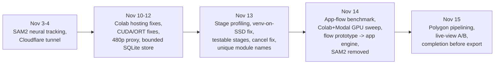
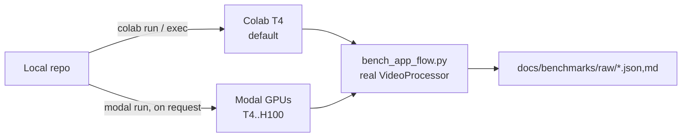
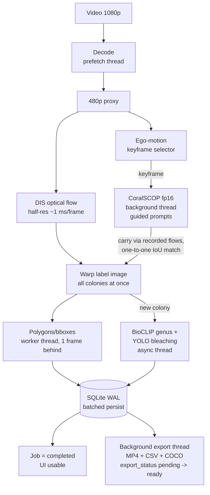

# ReefVision video pipeline: work summary (Nov 3 - 15, 2026)

Short technical record of the video-pipeline work, the Colab/Modal cloud-GPU tooling, and the benchmarks. Details live in `docs/benchmarks/`.

## 1. Outcome in one table

| | Start (SAM2 tracker) | Now (optical-flow tracker) |
|---|---:|---:|
| 8 s / 202-frame 1080p clip, Modal T4, end to end | 96.7 s (2.1 FPS) | 12.3 s (16.4 FPS) |
| Tracking loop only | 2.1 FPS | ~25 FPS |
| Colab T4 (2 vCPU), time until results usable | 26.7 s | 14.9 s |
| Real-time factor | 0.08x | 0.8-1.5x depending on GPU |

## 2. Timeline



## 3. Cloud GPU tooling (Colab CLI and Modal)

- **Colab CLI** (`colab new/exec/stop`, `colab run --gpu T4`): default for GPU tests. Fixes needed to run the full app there: venv on local SSD (Drive is `noexec`), bootstrap pip with `--without-pip` and patch `pyvenv.cfg`, drain `cloudflared` output and verify edge DNS (stopped Cloudflare 502s), serve the built frontend directly from FastAPI on port 8000.
- **Modal** (`modal run`, profile `ctrlxharsh`): used for the multi-GPU sweep (T4, L4, A10G, L40S, A100-40/80, H100). Runners: `backend/modal_bench.py` (SAM2 pipeline) and `backend/modal_flow.py` (flow pipeline). Image installs `onnxruntime-gpu[cuda,cudnn]`; an earlier run silently fell back to CPU because `libcurand` was missing. Policy: Colab first, Modal only on request, never run the full pipeline locally.
- **Harness**: `backend/bench_app_flow.py` drives the real `VideoProcessor` from outside (1 cold + 2 warm runs, per-stage timing, CPU/GPU sampling, `--poll-ui live` to mimic the results view).



## 4. Diagnosis: why the SAM2 pipeline was slow

Benchmark of the app's exact flow (`docs/benchmarks/video_pipeline_gpu_bench.md`):
- SAM2 propagation was 67-83% of wall time, ~20 ms per tracked object per frame, linear in colony count (27 colonies -> ~350 ms/frame). It is kernel-launch/CPU bound (~5,000 tiny kernels per frame, GPU idle ~50%), so a faster GPU barely helped: H100 (65 s) was no faster than A10G (65 s); L40S was best at 51 s.
- CoralSCOP keyframe discovery scaled with the GPU (1.4 s on T4 to 0.18 s on H100) but was only 3-14% of time.

Bugs found on the way: missing `psutil` requirement, ORT reporting CUDA success while on CPU, `compile_tracker` CUDA-graph crash (left unfixed, then moot), `tracker_fps` reset per chunk.

## 5. The redesign: dense optical-flow mask propagation

Insight: corals are static, the camera moves. Instead of tracking each colony, warp one label image per frame.



Key techniques:
1. **Flow warp** of a single label image: cost independent of colony count.
2. **Guided keyframe prompts**: one point per known colony plus grid points only where nothing is known (thinning the plain grid to 12x12 or 8x8 lost most masks).
3. **fp16 CoralSCOP** (encoder + decoder) and half-resolution mask decode: T4 1370 -> 817 ms, ~0.99 mask agreement; async queue so tracking never blocks on SAM.
4. **Async classification** of each new colony once, from a padded full-res crop.
5. **Prototype first** (standalone script + Modal runner), then moved into `core/video/flow_tracking.py` (`FlowTracker`) and the engine; SAM2 tracker and UI options removed.

## 6. Results by GPU (flow pipeline, 202 frames, all stages)

| GPU | wall s | FPS | x real time |
|---|---:|---:|---:|
| T4 | 10.3 | 19.7 | 0.79 |
| L4 | 8.1 | 25.0 | 1.00 |
| A10G | 6.2 | 32.6 | 1.30 |
| L40S | 6.1 | 33.2 | 1.33 |
| A100-40GB | 8.4 | 23.9 | 0.96 |
| A100-80GB | 10.3 | 19.6 | 0.78 |
| H100 | 5.5 | 36.5 | 1.46 |

From A10G up the host CPU (decode, ego-motion, flow) is the limit, not the GPU.

## 7. App-level optimisations (Nov 15)

| Change | Effect |
|---|---|
| Simplify outlines (approxPolyDP, ~6x fewer points), numpy scaling, geometry in a worker thread one frame behind | T4 loop 18 -> 25 FPS; e2e 12.4 -> 16.4 FPS |
| Report `completed` once frames are persisted; export MP4/CSV/COCO in background | Colab T4 results ready 26.7 -> 14.9 s (-44%) |
| Prefetch-decode thread (`_FramePrefetcher`) | +few % loop FPS on 2 vCPUs |
| Live-results polling A/B | Costs only ~5% loop FPS, so the live view stays |
| ffmpeg given time to finalise MP4 (was "unreadable or corrupted") | Annotated MP4 export fixed |

Remaining ceiling on Colab: ~10 s MP4 encode (CPU) and sequential ego-motion/flow on the main thread.

## 8. Correctness and engineering fixes

- Keyframe polygons/masks scaled from the 480p proxy to full-res coordinates; masks scaled from the array actually segmented.
- Cancel works end to end; overlay labels no longer stack; old jobs no longer restored on app open; async enrichment reaper uses the right track store.
- Scrubber/playback, telemetry HUD, pipeline log streaming; H.264 `avc1` plus range streaming for browser playback.
- Refactors: `_run_job_pipeline` split into pure tested stages (`pipeline_stages.py`), typed segment schema (`core/schema.py`), unique backend module names, `UploadView` split into tab components, code map in `AGENTS.md`.
- `dist/` untracked; tests: `test_pipeline_stages.py`, `test_flow_tracking.py`, `test_video_pipeline.py`, `test_api.py`.

## 9. Known caveats and next steps

- **Accuracy unverified**: warped masks vs a fresh keyframe detection have IoU ~0.71 after ~25 flow-only frames; edges drift, tall colonies and newly exposed area are weaker than a tracker. No ground truth; colony IDs (29-36) and genus/bleaching mix vary run to run (27 IDs under SAM2).
- Results are timing dependent (keyframe lag 6-21 frames by GPU), not bit-reproducible.
- Next: labelled-clip accuracy evaluation, overlap ego-motion/flow with decode on multi-core hosts, NVENC or proxy-res overlay rendering for the MP4, lazy MP4 export.

## 10. Reproduce

```bash
python backend/bench_app_flow.py --runs 3 [--poll-ui live]   # real engine, local/Colab (use Colab per project policy)
BENCH_GPU=T4 modal run backend/modal_flow.py                  # Modal
```
